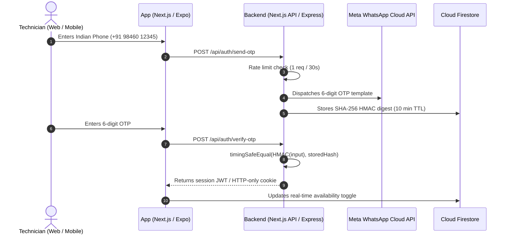

# CrewHive Monorepo Architecture Specification

> **System**: CrewHive Audio-Visual & Events Crew Network  
> **Architecture Pattern**: Unified Multi-App Monorepo with Shared Domain Core  
> **Package Management**: npm Workspaces  
> **Status**: APPROVED & IMPLEMENTED  

---

## 1. System Topology & Directory Structure

```text
CrewHive/
│
├── apps/
│   │
│   ├── web/                               # Next.js 16 Web Application (App Router)
│   │   ├── app/                           # Web Pages, Layouts & Active Next.js API Routes
│   │   ├── components/                    # Web UI Component Tree & Shadcn UI
│   │   ├── context/                       # React Context Providers (Auth, Language)
│   │   ├── hooks/                         # Client React Hooks
│   │   ├── lib/                           # Server Utilities, Firebase Web/Admin, WhatsApp
│   │   ├── locales/                       # Bilingual JSON Dictionaries (en, ml)
│   │   ├── public/                        # Static Assets (Logos, Icons, Illustrations)
│   │   ├── scripts/                       # Website Verification & Test Suites
│   │   ├── styles/                        # CSS Stylesheets & Tailwind Config
│   │   ├── tests/                         # Native Node.js Test Suites (28 Passing Tests)
│   │   ├── utils/                         # Web Utility Helpers
│   │   ├── next.config.mjs                # Next.js 16 Config
│   │   ├── postcss.config.mjs             # PostCSS Config (Tailwind CSS v4)
│   │   ├── tsconfig.json                  # Path Aliases (@/* -> apps/web/*)
│   │   ├── package.json                   # Web Dependencies & Scripts (@crew-hive/web)
│   │   └── .env.example                   # Web Client & Server Environment Template
│   │
│   └── mobile/                            # React Native Mobile Application (Expo SDK 54)
│       ├── assets/                        # Mobile Splash, Icons & Visual Assets
│       ├── App.js                         # Mobile Root Component
│       ├── index.js                       # Expo Registration Entrypoint
│       ├── app.json                       # Expo Application Manifest (SDK 54)
│       ├── babel.config.js                # Babel Config with NativeWind & Reanimated
│       ├── metro.config.js                # Metro Bundler Config
│       ├── tailwind.config.js             # NativeWind Mobile Tailwind Config
│       ├── global.css                     # NativeWind Global Stylesheet
│       ├── package.json                   # Mobile Dependencies & Scripts (crewhiveapp)
│       └── .env.example                   # Mobile Public Expo Configuration Template
│
├── services/
│   │
│   └── api/                               # Shared Node.js Backend Service
│       ├── src/
│       │   ├── config/                    # Environment, Port & Service Configuration
│       │   ├── controllers/               # Express Request Controllers
│       │   ├── routes/                    # API Route Handlers & Healthcheck
│       │   ├── middleware/                # AuthGuard, Rate Limiting & Error Handlers
│       │   ├── services/                  # Business Logic, OTP & Dispatch Services
│       │   ├── models/                    # Shared Firestore Data Access Layer
│       │   ├── validators/                # Request Validation Schemas
│       │   ├── integrations/              # MSG91, Meta WhatsApp & Firebase Admin
│       │   ├── jobs/                      # Scheduled Expiry & Cleanup Cron Workers
│       │   ├── utils/                     # Formatting & Cryptographic Utilities
│       │   └── app.js                     # Express Application Factory & HTTP Fallback
│       ├── tests/                         # Automated API Integration Tests
│       ├── server.js                      # Service Bootstrap Entrypoint (Port 4000)
│       ├── package.json                   # API Service Dependencies (@crew-hive/api)
│       └── .env.example                   # Server-only Secrets Template
│
├── packages/
│   │
│   └── shared/                            # Universal Platform-Agnostic Domain Package
│       ├── src/
│       │   ├── constants/                 # UI Tokens, Timeouts, Pagination & Consent Items
│       │   ├── enums/                     # UserRole, AvailabilityStatus, RequestStatus, Tiers
│       │   ├── role-taxonomy/             # 10 Parent Roles, 34 Specialisations (EN & ML)
│       │   ├── cities/                    # Launch Cities & 14 Kerala Revenue Districts
│       │   ├── validation/                # Indian Phone (+91), 6-digit OTP, Name, URLs
│       │   ├── api-contracts/             # Standard API Payloads, Error Codes & Enums
│       │   ├── utils/                     # Completeness Algorithm, PhoneToDocId, Currency
│       │   └── index.js                   # Universal Barrel Export
│       ├── tests/                         # Automated Unit Tests (7 Passing Tests)
│       └── package.json                   # Workspace Package Config (@crew-hive/shared)
│
├── firebase/                              # Centralized Firebase Configuration
│   ├── firestore.rules                    # Canonical Firestore Security Rules
│   └── firebase.json                      # Local Firebase CLI Manifest
│
├── docs/                                  # Monorepo Documentation Hub
│   ├── architecture/                      # System Architecture & Topology Specs
│   ├── api/                               # Next.js to Express API Migration Map
│   ├── setup/                             # Developer Onboarding & Environment Guide
│   └── migration/                         # Pre-migration & Execution Audit Logs
│
├── firebase.json                          # Root Firebase CLI Config pointing to firebase/
├── package.json                           # Root Monorepo Orchestration Package
├── package-lock.json                      # Monorepo Dependency Lockfile
├── .gitignore                             # Unified Git Ignore Rules
└── README.md                              # Repository Overview & Quickstart Guide
```

---

## 2. Component Architecture & Responsibilities

### 2.1 Next.js Web Application (`apps/web`)
- **Technology**: Next.js 16.2.0, React 19, Tailwind CSS v4, Lucide React, Radix UI.
- **Responsibilities**:
  - Public marketing homepage with bilingual localization (`/`).
  - 30-Second Fast-Track Crew Registration Wizard (`/crew/onboarding`).
  - Technician Profile & Availability Dashboard (`/crew/dashboard`, `/crew/setup`).
  - Recruiter Discovery Engine & Role Filter Matrix (`/organizer/search`, `/recruiter/register`).
  - Recruiter Outreach & Ping Management Center (`/organizer/dashboard`, `/organizer/requests`).
  - Association Portals (`/for-associations`, `/association/portal`).
  - Super-Admin & Moderation Panel (`/admin`, `/super-admin/dashboard`).
  - Active Next.js API Routes (35 production endpoints serving live web clients).

### 2.2 React Native Expo Application (`apps/mobile`)
- **Technology**: Expo SDK 54, React Native 0.81.5, React 19.1.0, NativeWind 4.2.1, TanStack Query, Zustand.
- **Responsibilities**:
  - Native mobile application for AV and event technicians.
  - Native push notifications and WebOTP auto-fill.
  - Coarse GPS district capture for active availability toggle.
  - Offline-first cache for incoming booking alerts.

### 2.3 Shared Express Backend Service (`services/api`)
- **Technology**: Node.js 20, Express 4.21, Firebase Admin SDK 13.8.
- **Current Status**: **Scaffolded Architectural Blueprint (Backend Migration Pending)**.
- **Responsibilities**:
  - Serves centralized REST endpoints consumed identically by Web and Mobile.
  - Encapsulates Firebase Admin operations and server-side secret management.
  - Executes background cron jobs (7-day availability expiry, 2-hour ping expiration).
  - Handles incoming webhooks from Meta WhatsApp Cloud API and MSG91 telephony.

### 2.4 Shared Domain Core Package (`packages/shared`)
- **Technology**: Pure ECMAScript (ESM), zero platform dependencies.
- **Responsibilities**:
  - Prevents drift in role names, Malayalam translations, and launch city definitions.
  - Enforces identical validation logic (e.g. phone sanitization and OTP regex) in Web, Mobile, and API.
  - Calculates profile completeness deterministically across all platforms.
  - Formats day rates, dates, and phone displays consistently.

---

## 3. Data Layer & Firebase Architecture

### 3.1 Single Shared Cloud Firestore Database
Both the Web application, Mobile application, and Express API interface with a **single, unified Cloud Firestore database**. No secondary databases exist.

```text
Firestore Root
├── users/                   # Core authentication and user metadata documents
├── crew_profiles/           # Technician portfolios, roles, rates, and gear records
├── availability/            # Real-time availability toggles, districts, and expiry timestamps
├── availability_requests/   # Recruiter outreach pings with 2-hour SLA lifecycles
├── association_inquiries/   # Institutional partner leads (FEFKA, IALVP)
├── associations/            # Verified association registries and member rosters
├── admin_audit_logs/        # Immutable system moderation and action logs
└── cost_telemetry/          # SMS OTP (₹0.12) and WhatsApp Utility (₹0.80) expenditure records
```

### 3.2 Canonical Document Identification (`phoneToDocId`)
To ensure cross-channel identity persistence between Web and WhatsApp, all user and crew profile documents use a deterministic ID scheme:
$$\text{docId} = \text{"c\_"} + \text{E164Digits}$$
*Example*: Phone `+91 98460 12345` $\rightarrow$ Document ID `c_919846012345`.

---

## 4. Communication & Security Architecture



---

## 5. Deployment & Workspace Isolation

| Workspace | Artifact Type | Deployment Target | Isolation Level |
| :--- | :--- | :--- | :--- |
| `apps/web` | Standalone Node/SSR | Vercel / Cloud Run | Isolated web bundle |
| `apps/mobile` | Native APK / AAB / IPA | Google Play / Apple App Store | Client-only binary |
| `services/api` | Containerized Microservice | Google Cloud Run / AWS ECS | Server-side VPC |
| `packages/shared` | Internal Workspace Link | Bundled into dependents | Zero runtime footprint |
| `firebase/` | Declarative Rules Manifest | Firebase Hosting / Firestore CLI | Rules-only deploy |

